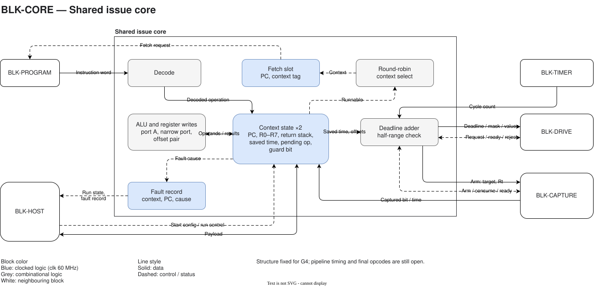

# BLK-CORE — Shared issue core
- Status: agreed
- Traces to: DEC-001, SPEC-PROG-001, SPEC-PROG-002, SPEC-PROG-003, REQ-PROTO-004

## Purpose

Run two contexts through one fetch/execute path. Each context owns its PC, registers, flags, return stack and pending operation. Protocol policy stays in the loaded program.

## Block diagram

[Editable draw.io source](diagrams/blk-core_v1.drawio). Solid arrows carry data, dashed arrows control and status; blue blocks are clocked at 60 MHz, grey blocks are combinational, white blocks are neighbours. The core's pipeline timing and final opcodes are still open; the drawing may change after the full-core timing check.

[Issue-core sequence](sequences.md#issue-core)

## Interface

| Signal group | Dir | Width | Meaning |
|---|---|---|---|
| `fetch_req`, `fetch_rsp` | Out, In | `valid` + 7-bit PC, `valid` + 24-bit instruction or fault | One outstanding fetch; retain its context tag locally |
| `start_cfg`, `run_ctl`, `run_status` | In, In, Out | Two 7-bit entry PCs, context enable bits and ownership masks; run/flush; run state and fault record | Loader supplies committed configuration; the core reports `RUNNING`/`DONE`/`FAULTED` and one fault record (context, PC, cause) ([CHG-008](../changes/CHG-008-stop-ordering.md)) |
| `cycle` | In | `W` | Issue-cycle timebase |
| `drive_req/status`, `capture_req/status` | Out/In | See BLK-DRIVE and BLK-CAPTURE | Requests are owned by the issuing context |
| `payload` | In/Out | Draft `ready/valid` plus 16-bit word per direction and context tag | Buffered host data; waiting affects only the requesting context |

Draft schedule: a registered fetch slot followed by an execute slot. A taken branch adds a redirect slot in the current model; keep that cost for the first replay. The evaluated state size is eight 16-bit registers and two return addresses per context. The [draft ISA](isa-draft.md) defines decode and the stack and image-bound faults. Final opcode values and the R0/R6 offset-register assignment stay provisional until RTL.

## Captured time

[DEC-003](../04_decisions/DEC-003-isa-timestamps.md) adds one 24-bit saved timestamp and a valid bit per context, separate from the general registers. When a capture consume explicitly requests a timestamp save, it copies that context's stored observation timestamp into the register. A consume without a save leaves the saved timestamp unchanged. Reset, start and global flush clear timestamp validity.

Timed drive and sample instructions can use `saved_timestamp + offset`, reduced modulo `2^24`, as an absolute deadline. An instruction that requests an invalid timestamp faults without issuing a timed request. Apply the BLK-TIMER half-range rule at admission. The draft ISA fixes the offset fields (9-bit immediate, 23-bit offset pair through `addoff`). Each context has one saved timestamp.

[CHG-006](../changes/CHG-006-edge-interval.md) adds `edge_save` and `edge_delta`. Both wait for the selected transition in the owning capture slot. On success, save the observation timestamp and clear the offset pair. `edge_delta` requires a valid saved time before arming. Subtract it from the new observation modulo `2^24`. If the interval is zero or at least `2^23`, fault without committing an interval or a new timestamp. On success, return bits `[15:0]` in `Rd` and zero-extend bits `[23:16]` into `Rd+1`. In the draft `R0`/`R6` offset convention, `Rd` is `R1` through `R4`. Write both words on the retirement edge ([CHG-009](../changes/CHG-009-delta-writeback.md)): `Rd` through write port A, and `Rd+1` through a narrow port that reaches only R2–R5 and writes `{9'b0, interval[22:16]}`. The offset-pair clear uses its own path on the same edge. The three targets are always different registers. No extra issue slot is used.

[CHG-007](../changes/CHG-007-modular-guards.md) defines the time guards of `fence` and `wait_save`. On the first execute of a `fence`, compute `delta = (target − cycle) mod 2^24`. If `delta` is 1 through `2^23 − 1`, wait until `cycle == target`. If `delta` is zero or at least `2^23`, the target is reached: retire without a fault. Keep the target in the pending operation and one guard-open bit per context. Once open, the guard stays open until retirement, flush, fault or reset; do not re-compare. Pass a `wait_save` target to BLK-CAPTURE, which applies the same rule at arm. A `wait_save` without a saved time has no guard. Drive and sample admission keep their fault rule. Software must arm a guard within `2^23 − 1` cycles of its target; an older target aliases as a future one.

[CHG-013](../changes/CHG-013-timed-wait.md) adds `wait_to`: a `wait_save` with an expiry `Rt × 64` cycles after its guard target. At the first execute, check that the expiry is in the future half with the deadline adder, or fault. Pass `Rt` with the arm request. On expiry, write `Rt = 0` and leave the saved time and offset unchanged; on a match, behave as `wait_save`.

Use round-robin selection between runnable contexts at a free issue boundary; waiting on capture, payload or output credit must not hold the shared path. Save the decoded request and its original operands (including any capture-derived absolute deadline) on first block. Retry as that context's next operation when eligible, without a second fetch or recomputing the deadline. A waiting output request becomes eligible to report an invalid deadline even if no queue space opens. Advance PC and write architectural state only on successful retirement. An invalid operation does not retire: no PC advance, register write, FIFO transfer, queue entry or arm. Under [CHG-008](../changes/CHG-008-stop-ordering.md), the fault is detected on the edge F where the context tries to execute it, and nothing else issues on F. Register the fault; F + 1 is the global safe edge. On it, both contexts lose pending operations and guard bits, and issue stops. Latch one fault record (context, PC, cause class; codes provisional) in `run_status`. `halt` ends only its own context: its accepted output updates still retire and the other context continues. Report `DONE` when every enabled context has halted and the drive queue is empty. A global fault, `STOP`, reset or deselect discards pending work in both contexts, including updates a halted context still has queued. Registers are not host-visible after a stop and `START` clears them, so a stop between the two `edge_delta` writes is not observable.

## Implementation options and budget

The draft `host_get` and `host_put` operate only on the issuing context's FIFOs. A blocked read retains its destination register. A blocked write retains the source word. On the successful handshake, retire the instruction and transfer one word. Do not advance the PC, change the destination, or modify a FIFO while blocked. The other context can issue. See [CHG-005](../changes/CHG-005-host-payload.md). Eligibility comes from the FIFO count registered before the edge ([CHG-010](../changes/CHG-010-payload-fifo.md)): a word the host writes on the same edge becomes visible on the next one.

[DEC-004](../04_decisions/DEC-004-hybrid-pad-isa.md) selects compact `pad`/`pad2` and vector `drivev` for the [draft ISA](isa-draft.md). Decode either format into the same absolute deadline, mask, value and output enable request. Separate `shift_pin` and `shift_pair` keep all eight pin indices usable. `shift_pin` bit 20 selects the order ([CHG-012](../changes/CHG-012-shift-lsb.md)): `0` sends bit 15 and shifts left, `1` sends bit 0 and shifts right with zero fill. The update rule below applies to both orders. Change the shift source register only when its request is admitted. On block, retain the decoded request and defer the register update. On reject, leave the register unchanged.

Saved requests are the contract ([EVAL-003](../evals/EVAL-003-g4-timed-io.md)); re-fetch would cost issue bandwidth and could recompute a relative deadline. Quantify runnable service bound, retries and actual deadline slack against EVAL-001's critical cases; round-robin is not a proof of schedulability. Planning allowance: 0.150 mm² of cell area; not measured for this block.

## Unit-test plan and RTL

With stubbed endpoints, check independent context state, branch cost, blocked issue, retry identity, no duplicate retirement, and fault handling. Planned file: `src/issue_core.v`.
