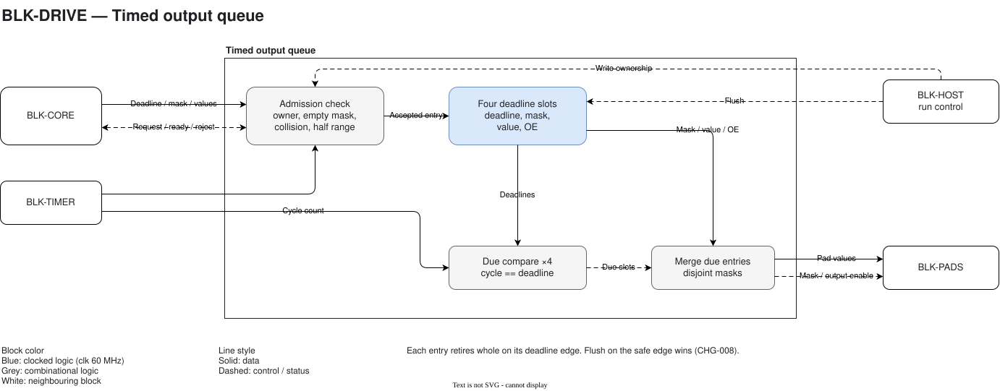

# BLK-DRIVE — Timed output queue
- Status: implemented
- Traces to: DEC-001, SPEC-UART-001, SPEC-SPI-001, SPEC-I2C-001, REQ-PROTO-004

## Purpose

Hold accepted masked pad updates until their deadlines. Retire updates without using a core issue slot or waiting for a context to become runnable.

## Block diagram

[Editable draw.io source](diagrams/blk-drive_v1.drawio). Solid arrows carry data, dashed arrows control and status; blue blocks are clocked at 60 MHz, grey blocks are combinational, white blocks are neighbours.

[Timed output sequence](sequences.md#timed-output)

## Interface

| Signal group | Dir | Width | Meaning |
|---|---|---|---|
| `cycle` | In | `W` | Cycle timebase from BLK-TIMER |
| `write_owner` | In | Two `P`-bit masks | Committed per-context write ownership, stable during a run |
| `drive_req` | In | `valid`, 1-bit context, `W`-bit deadline, `P` bits each for mask/value/OE | One candidate update per cycle; `P=8` provisional |
| `drive_status` | Out | `ready`, `reject` | With `valid`, `reject` consumes a bad request without enqueueing, else `ready` accepts it; if neither is set, retry later |
| `pad_update` | Out | `P` bits each for mask/value/OE | Merged updates due this edge, consumed by the pad registers |
| `flush` | In | 1 | Discard live entries; suppress due updates on that edge |

Draft contract: four unordered slots. All due slots retire on their deadline edge. Merge disjoint masks even when they belong to different contexts. Reject a new request if its mask is empty, touches a pad outside its context's write ownership, overlaps a live mask at the same deadline, or fails BLK-TIMER's deadline rule. Reject takes precedence over full for the presented request. A due slot can be reused on its retirement edge. A newly accepted event cannot retire on that edge. Reset and flush override both acceptance and retirement. After a core fault on edge F, updates due on F retire normally; `flush` arrives on F + 1 and suppresses updates due on it ([CHG-008](../changes/CHG-008-stop-ordering.md)). Each entry retires completely or not at all.

On full, no write or PC advance occurs. The core retains the blocked operation and can issue the other context. Revalidate at each retry: a request which reaches its deadline while blocked is rejected and faults rather than changing a pad late. When both contexts want a free slot, the shared issue rule decides who gets it. There is no per-context reservation in this draft, so it does not guarantee admission under arbitrary shared load.

The queue receives an absolute deadline even when the core derives it from a captured timestamp. It does not add the offset, substitute the current cycle, or change the deadline on retry.

One accepted request occupies one entry, regardless of how many pads its mask selects. A vector request uses one free slot and admits the full mask, values and enables together. Separate compact requests are admitted independently, even when they share a deadline. The queue handles both formats without decoding opcodes.

## Implementation options and budget

Use unordered slots with a due scan, as replayed in [EVAL-003](../evals/EVAL-003-g4-timed-io.md); a plain FIFO could hide an earlier event behind a later one, and ordering alone would not solve simultaneous retirement. Test scan, merge and OE timing together: the [EVAL-008 slice](../evals/EVAL-008-eight-pad-timing.md) met placed setup but missed fast hold. Planning allowance: 0.075 mm² of cell area; not measured for this block.

## Unit-test plan and RTL

The standalone implementation is [`src/timed_drive.v`](../../src/timed_drive.v). `drive_credit` includes slots due on the sampling edge and does not depend on the selected request. `drive_empty` reports registered occupancy, so a live final update keeps it low until retirement. BLK-PADS will register the merged update and apply the pad drive mode.

TEST-UNIT-003 compares the queue against an event scoreboard. It uses a stub for the core's registered fault-to-flush signal and checks the update bus, not the physical pads.
