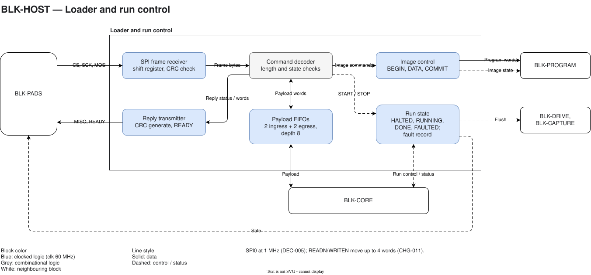

# BLK-HOST — Loader and run control
- Status: draft
- Traces to: DEC-001, SPEC-HOST-001, SPEC-RST-001, SPEC-RST-002, SPEC-PROG-001

## Purpose

Accept an image and configuration from the RP2350 while halted. Publish completion separately from start, and buffer payload/status without putting the host in the pin timing loop.

## Block diagram

[Editable draw.io source](diagrams/blk-host_v1.drawio). Solid arrows carry data, dashed arrows control and status; blue blocks are clocked at 60 MHz, grey blocks are combinational, white blocks are neighbours.

[Loader and run-control sequence](sequences.md#host)

## Interface

| Signal group | Dir | Width | Meaning |
|---|---|---|---|
| `host_link` | In/Out | 3 in, 2 out | Synchronized `host_cs_n`, `host_sck`, `host_mosi`; registered `host_miso`, `host_ready` |
| `selected` | In | 1 | Synchronized `ena` from BLK-PADS |
| `prog_write`, `image_state` | Out | See BLK-PROGRAM | Write complete words; own committed word count and validity |
| `start_cfg`, `run_ctl`, `run_status` | Out, Out, In | See BLK-CORE | Start both enabled contexts atomically; latch stop/fault status |
| `write_owner`, `pad_mode` | Out | Two `P`-bit masks, `P` bits | Committed output ownership and electrical modes, stable during a run |
| `payload` | In/Out | 16-bit word plus context and ready/valid, each direction | Separate ingress and egress FIFO per context; eight words each ([CHG-010](../changes/CHG-010-payload-fifo.md)) |
| `flush`, `safe` | Out | 1 each | Clear pending I/O and release protocol outputs on global stop/fault/reset |

## SPI and load sequence

Use RP2350 SPI0, mode 0 at 1 MHz ([DEC-005](../04_decisions/DEC-005-loader-rate.md); 250 kHz before [CHG-011](../changes/CHG-011-loader-rate.md)). SCK is idle low; bits go most-significant first, with sampling on rising SCK. The ASIC samples synchronized host inputs on its 60 MHz clock. Hold `CS` high between frames. Issue one command per request frame. When `READY` is high between frames, the next frame reads the pending reply and the loader ignores MOSI. Preload the first reply bit before the first rising SCK. Keep the pending reply until the host clocks a complete reply. EVAL-004 modeled 2 µs lead and lag guards on `CS` and a further 20 µs inter-frame budget; confirm the settings in firmware.

A request contains an opcode byte, a 16-bit little-endian body length, the body, then CRC-16/CCITT-FALSE over the preceding bytes (initial `0xFFFF`; CRC bytes little-endian). Replies use the same framing with a status byte instead of the opcode. Numeric opcode and status values are still draft.

| Command | Contract |
|---|---|
| `BEGIN` | While halted, invalidate the old image. Accept byte fields for word count (1–128), context enable mask, two entry PCs, two output ownership masks and open-drain mask. Enabled PCs must address the declared image. Ownership masks must be disjoint; open-drain bits must belong to a write mask. |
| `DATA` | Send exactly the declared number of 24-bit words, little-endian. Write tentative words into the halted store at consecutive indices starting from zero. A bad length, truncated load, or bad CRC leaves the image invalid. |
| `COMMIT` | Mark a fully received, validated image complete and report completion. Do not run it. |
| `START` | Start enabled contexts together from the committed PCs with clean execution and timed-I/O state. Preloaded payload remains in the ingress FIFOs. Reject start without a committed image or outside `HALTED`. |
| `STOP` | On the ASIC edge after the validated frame close, make the pads safe, invalidate the image and clear pending work. Acknowledge after the safe edge. The reply carries the run state and fault record latched before the stop. |
| Payload write/read | Select the context. Writes enqueue ingress or report full without overwriting; reads dequeue egress or report empty. A full core result FIFO blocks only the reporting context. Plan to preload inputs and drain results outside timing-critical transactions. |
| `READN` | Select the context and a count of 1–4. Reply `OK` with up to that many egress words, or `EMPTY`. Keep the words in the FIFO while the reply is sent; free them only on an exact-length reply close, so a restarted reply sends the same words ([CHG-011](../changes/CHG-011-loader-rate.md)). |
| `WRITEN` | Select the context and send 1–4 words. Write them tentatively into free ingress slots beyond the tail while the request arrives. On validation, commit the leading words that fit and reply with the accepted count: `OK` if all fit, `FULL` if fewer. A bad length or CRC commits nothing ([CHG-011](../changes/CHG-011-loader-rate.md)). |

Load commands have no effect while running. Reset makes the device safe on the first edge sampling reset low. Deselect makes it safe on the edge that sees synchronized `ena` low, if the ASIC is still clocked. Reset, stop and deselect invalidate the image and clear payload and timed work. `safe` and `flush` win over a coincident pad update. Reset and reload after reselection; require a fresh load after a global stop or fault.

Run states ([CHG-008](../changes/CHG-008-stop-ordering.md)):

| State | Entered by | Pads | Image and payload FIFOs |
|---|---|---|---|
| `HALTED` | Reset, deselect, `STOP` | Safe | Invalid / cleared |
| `RUNNING` | `START` with a committed image | Programmed | In use |
| `DONE` | Every enabled context halted and the drive queue empty | Hold their last values | Kept for the host to drain |
| `FAULTED` | Core fault; safe edge is the edge after detection | Safe | Kept for the host to drain and read the fault record |

Leave `DONE` or `FAULTED` only with `STOP`, reset or deselect. If a fault safe edge and a `STOP` safe edge coincide, there is one safe edge and the status reports `FAULTED`. After a stop or fault the host must reset or resynchronize protocol peers: the safe edge can release a pad one cycle after its last programmed change.

## Core payload interface

`host_get` consumes a word from the selected context's ingress FIFO. `host_put` produces a word for that context's egress FIFO. The core transfers a word only on a successful ready/valid handshake. Neither instruction addresses the other context or assigns a protocol meaning to the word. Host SPI `WRITE` and `READ` keep their existing behavior.

Same-edge rule ([CHG-010](../changes/CHG-010-payload-fifo.md)): each FIFO accepts from its count before the edge. A push needs count < 8, a pop count > 0. A push and a pop on one edge both take effect between those limits. At full, a push waits even if a pop happens on that edge; at empty, a pop waits even if a push happens. There is no pass-through. The core's `host_get`/`host_put` eligibility therefore comes from registered state, with no same-cycle path from host frame decode to issue. The host touches a FIFO only on the edge that validates its request frame or, for `READN`, closes its reply.

Host rates in the model ([EVAL-015](../evals/EVAL-015-host-rate.md)): at 1 MHz a single-word `READ` moves one word per 156 µs, and `READN`/`WRITEN` with four words one per 53 µs. With four-word transfers, UART streams at every common baud rate up to 115,200 are sustained in both directions. With single-word commands, a 115,200-baud stream stops after about 17 bytes. Standard-speed 1-Wire needs the host to poll during the ROM read, or the program to pack presence into a ROM word. Board delays are not modeled.

## Transfer recovery

Validate the request bit count, body length and CRC on synchronized `CS` rising. Do not execute a command before validation. Before frame close, only halted `DATA` may write tentative image words, and `WRITEN` may write tentative payload words into free ingress slots. Neither is visible until validation. If SCK stalls with `CS` low, keep counters bounded and wait for frame close or reset. There is no ASIC watchdog.

Reject short, overlong or malformed requests with a framed error reply. If halted, invalidate the image and abandon the load. If running, leave the running program unchanged. Keep the validated `STOP` safe-edge timing above.

If a reply ends early or has extra bits, keep `READY` high and retain the same reply. A new reply frame starts from bit zero without executing the original request again. Drop the reply and clear `READY` only on an exact-length reply close, reset or deselect. After reset or reselection, observe synchronized `CS` high before accepting a new falling edge.

The RP2350 uses provisional deadlines of 20 ms per request or reply frame and 5 ms for `READY` after a request closes. These deadlines do not extend the 1 s load requirement. The host checks the reply length, CRC and expected status with one `CS` assertion across the full reply. A valid error status is distinct from a transfer failure.

On timeout or an invalid reply, abort the transfer, return `CS` high and SCK low, and report the command outcome as unknown. Do not resend the command automatically. Reset for at least four clock edges. Hold `CS` high for at least 2 µs after reset release and require `READY` low within 5 ms before a fresh `BEGIN`. Report recovery failure if reset cannot be clocked or `READY` stays high. Reload and commit before an explicit `START`. Do not restart protocol traffic automatically. See [CHG-002](../changes/CHG-002-loader-recovery.md) for the host sequence and test cases.

## Implementation options and budget

[DEC-005](../04_decisions/DEC-005-loader-rate.md) keeps the dedicated SPI link chosen in DEC-002, at 1 MHz with four-word payload transfers. Stream words directly into BLK-PROGRAM; do not allocate a second image buffer. Four depth-8 FIFOs with multi-word host access map to 45,502 µm² (EVAL-015). The SPI framing, CRC and run-control area is not measured. Check 1 MHz on the board; the fallback is 500 kHz. Planning allowance: 0.090 mm² of cell area; not measured for this block.

## Unit-test plan and RTL

Check complete vs short and malformed transactions, completion then start, write protection, warm reset, stop while work is pending and reload after selection is lost. Planned file: `src/host_loader.v`.
