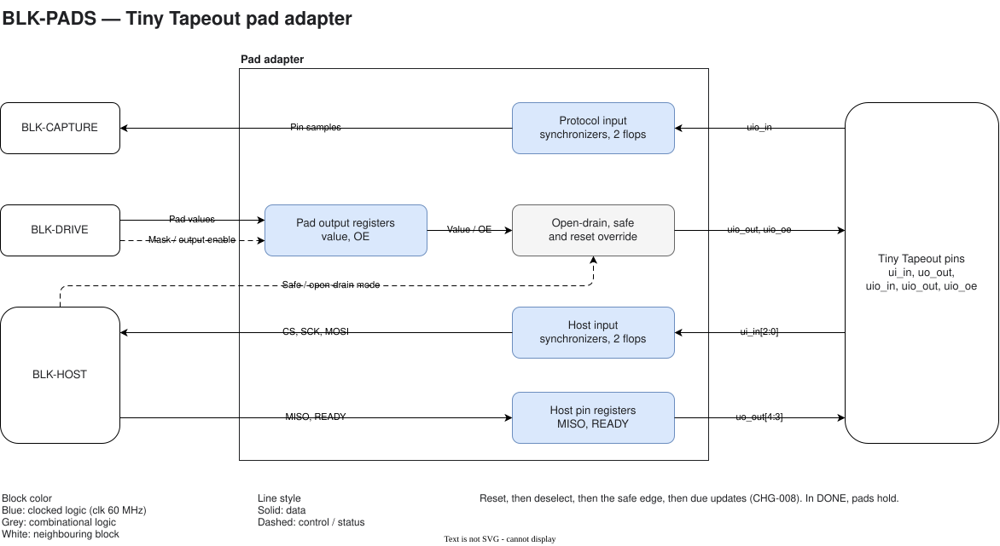

# BLK-PADS — Tiny Tapeout pad adapter
- Status: draft
- Traces to: DEC-001, REQ-RULE-003, REQ-RULE-007, REQ-PROTO-004, SPEC-RST-001, SPEC-I2C-001

## Purpose

Synchronize external inputs and drive protocol pads from registers. Map logical protocol pins and host signals onto the Tiny Tapeout ports. This block includes the wrapper boundary; it does not interpret host commands.

## Block diagram

[Editable draw.io source](diagrams/blk-pads_v1.drawio). Solid arrows carry data, dashed arrows control and status; blue blocks are clocked at 60 MHz, grey blocks are combinational, white blocks are neighbours.

## Interface

| Signal group | Dir | Width | Meaning |
|---|---|---|---|
| Tiny Tapeout ports | In/Out | 8 each for `ui_in`, `uo_out`, `uio_in`, `uio_out`, `uio_oe`; `clk`, `rst_n`, `ena` are single bits | Standard digital boundary |
| `pad_update`, `pad_mode` | In | `P` bits each for mask/value/OE, `P` open-drain mode bits | Draft `P=8`; apply only on a 60 MHz clock edge |
| `pin_sample`, `selected` | Out | `P`, 1 | Second-stage protocol samples and synchronized selection |
| `host_link` | In/Out | 3 in, 2 out | Synchronized host `CS`, `SCK`, `MOSI` into BLK-HOST; registered host `MISO`, `READY` to the RP2350 |
| `safe` | In | 1 | Force protocol output enables and drive values to zero at the sampling edge |

Use two flop stages on external inputs used by the design other than clock and reset. Capture reads the second stage. In push-pull mode a masked update sets drive value and OE; in open-drain mode `uio_out` stays zero and an update requesting high releases the pad. Reset and `safe` override a coincident pad update. Priority on one edge: reset, then deselect, then the safe edge (fault or `STOP`), then due updates ([CHG-008](../changes/CHG-008-stop-ordering.md)). In `DONE`, pads hold their last values until `STOP`; they do not go safe. Host status can report a fault after the protocol pads go safe; reset still clears both. Non-driven pins need an external pull-up or pull-down wherever the board connection requires a defined idle level.

The RP2350 holds `CS` high during recovery reset and for at least 2 µs after release. Pass synchronized `CS` to BLK-HOST so it can qualify a new frame. Reset and deselect clear the pending host reply and `READY` through BLK-HOST. The pin allocation does not change.

Apply the same registered `pad_update` for compact and vector operations. On a masked push-pull pad, a cleared enable releases the pad regardless of the value bit. On a masked open-drain pad, a high value or cleared enable releases the pad. Preserve unmasked pad state.

## Pin allocation

| Tiny Tapeout resource | Use |
|---|---|
| `ui_in[0]`, `ui_in[1]`, `ui_in[2]` | Host `CS` (active low), `SCK`, `MOSI`; ETR GPIO17, GPIO18, GPIO19 |
| `uo_out[3]`, `uo_out[4]` | Host `MISO`, `READY`; ETR GPIO36, GPIO37 |
| Other `ui_in` / `uo_out` | Ignore unused inputs and drive unused dedicated outputs low |
| `uio[0]` through `uio[3]` | Protocol SPI `CS`, `MOSI`, `MISO`, `SCK` in that order for the overlap example |
| `uio[6]` | UART RX for overlap; standalone UART may also drive TX on `uio[5]` |
| `uio[6]`, `uio[7]` in the separate I2C image | Open-drain `SCL`, `SDA`; external 3.3 V pull-ups |

The RP2350 bidirectional GPIOs must not drive or pull the protocol pads when external peers are connected. The overlap case uses five separate `uio` pads and does not share host pins. Verify wiring and electrical behavior on the actual board revision.

## Implementation options and budget

[DEC-005](../04_decisions/DEC-005-loader-rate.md) (replacing DEC-002) keeps host SPI on dedicated pins and leaves all eight bidirectional pads programmable. Check the first-stage input hold path after CTS and routing. Planning allowance: 0.040 mm² of cell area; not measured for this block.

## Unit-test plan and RTL

Check synchronizer depth, registered outputs, open drain, independent mask bits, and reset/stop precedence. Planned file: Tiny Tapeout wrapper in `src/`, with a separate pad module only if useful.
