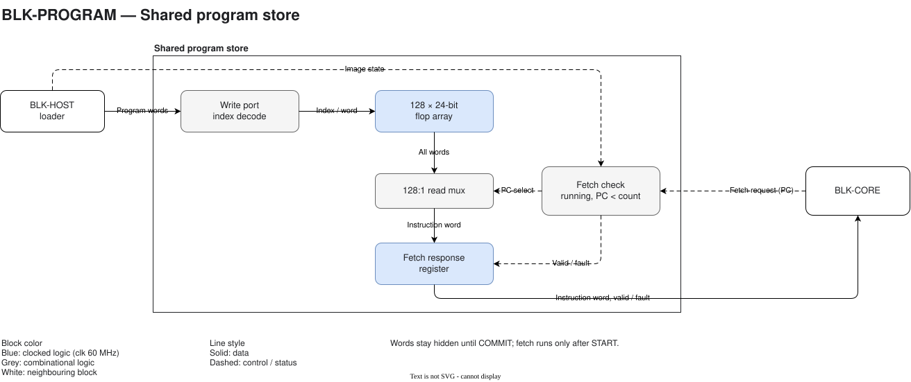

# BLK-PROGRAM — Shared program store
- Status: draft
- Traces to: DEC-001, SPEC-HOST-001, SPEC-RST-001, SPEC-PROG-001, SPEC-PHY-001

## Purpose

Hold one program image for both execution contexts. Keep uncommitted and uninitialized contents outside the fetch path.

## Block diagram

[Editable draw.io source](diagrams/blk-program_v1.drawio). Solid arrows carry data, dashed arrows control and status; blue blocks are clocked at 60 MHz, grey blocks are combinational, white blocks are neighbours.

## Interface

| Signal group | Dir | Width | Meaning |
|---|---|---|---|
| `prog_write` | In | `valid`, 7-bit index, 24-bit word | One complete word, assembled little-endian from the host `DATA` frame |
| `image_state` | In | `load_active`, `image_valid`, `running`, 8-bit word count | Loader owns image visibility and excludes simultaneous load and run |
| `fetch_req` | In | `valid`, 7-bit PC | One request from BLK-CORE |
| `fetch_rsp` | Out | `valid`, `fault`, 24-bit instruction | Registered result; no instruction for an out-of-image request |

Draft contract: 128 × 24-bit flop store, with registered read. A legal fetch sampled on edge `n` returns an instruction in the cycle following that edge, for execute on edge `n+1`; an out-of-image running fetch returns a fault instead. Fetch is disabled before a committed start. Reset clears response validity but not the storage array. The loader writes exactly the declared contiguous range before exposing it, so the previous contents of unwritten words are never executable. Reject writes outside halt/load; illegal overlap of read and write cannot expose partially updated data.

Write tentative words as the halted loader receives them, with `image_valid` low. Keep them hidden even if a late CRC or length failure leaves tentative writes in the array. A fresh `BEGIN` and valid full `DATA` frame are required before a new `COMMIT`; no duplicate array or storage clear is needed. Fetch remains disabled until `START`.

## Implementation options and budget

The store transports each compact or vector instruction as one unchanged 24-bit word. Opcode and operand checks belong to BLK-CORE. Neither encoding changes fetch latency, image visibility or word capacity.

Start from the evaluated flop array and registered mux. Compare mux partitioning if the 128-way read fails setup. Changing the storage technology needs an architecture decision. Planning allowance: 0.180 mm² of cell area; not measured for this block.

## Unit-test plan and RTL

Check first/last word, word counts 1 and 128, short reload, qualified writes, read latency, and reset visibility without assuming initialized memory. Planned file: `src/program_store.v`.
