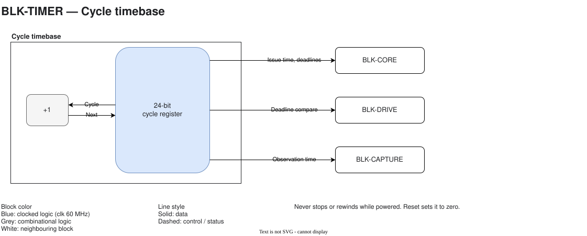

# BLK-TIMER — Cycle timebase
- Status: draft
- Traces to: DEC-001, SPEC-PHY-001, SPEC-RST-001, SPEC-I2C-003, SPEC-PROG-003

## Purpose

Provide a common cycle number for scheduling output changes and timestamping input observations. The counter does not stop when execution or either context stalls.

## Block diagram

[Editable draw.io source](diagrams/blk-timer_v1.drawio). Solid arrows carry data, dashed arrows control and status; blue blocks are clocked at 60 MHz, grey blocks are combinational, white blocks are neighbours.

[Timebase sequence](sequences.md#timebase)

## Interface

| Signal | Dir | Width | Meaning |
|---|---|---:|---|
| `clk`, `rst_n` | In | 1 each | Single 60 MHz domain, synchronous active-low reset |
| `cycle` | Out | 24 | Current cycle for issue, output deadlines and capture timestamps ([DEC-003](../04_decisions/DEC-003-isa-timestamps.md)) |

All consumers use the value of `cycle` immediately **before** the sampling edge. It equals zero before the first edge after reset release and increments on that edge. Start, halt and fault do not rewind time. An event with `deadline == cycle` acts on that edge.

For a new timed request, compute `(deadline - cycle) mod 2^W`. Accept only values from 1 through `2^(W-1)-1`. Zero, half range and values above half range are invalid, not a request to fire now. Software must obey the same half-range rule: a far-out absolute timestamp can alias a near-future one. Accepted requests are compared by equality, not unsigned timestamp order.

The shared timebase does not change under DEC-003. BLK-CORE's saved timestamps are copies of observation times, not separate running counters. A deadline derived from one of those copies obeys the same admission rule.

The timebase also supplies the timestamps for `edge_delta`. The core uses `(observation − saved) mod 2^24` and accepts intervals from 1 through `2^23−1` cycles. Crossing one wrap works within that interval. The counter does not report how many wraps occurred. Software must bound the time between observations to avoid aliasing an old time.

Time guards (`fence`, guarded `wait_save`) use the same `delta`, but differently ([CHG-007](../changes/CHG-007-modular-guards.md)). Classify once when the guard arms. `1` through `2^23 − 1` waits for `cycle == target`. Zero or the past half means already reached, not invalid. The consumer keeps an open bit, so a guard never depends on a continuous half-range compare that could close it again after `2^23` cycles.

## Implementation options and budget

Use 24 bits: timestamps (DEC-003), guards (CHG-007), elapsed time and timed waits (CHG-013) all assume it. The half range is about 140 ms at 60 MHz; 16 bits would give only 546 µs, less than a 1-Wire reset and recovery. A split coarse/fine counter is an RTL option only if the carry path or fanout fails timing. Planning allowance: 0.025 mm² of cell area; not measured for this block.

## Unit-test plan and RTL

Exercise reset, exact increment, half-range boundaries and wrap. Planned file: `src/cycle_timer.v`.
