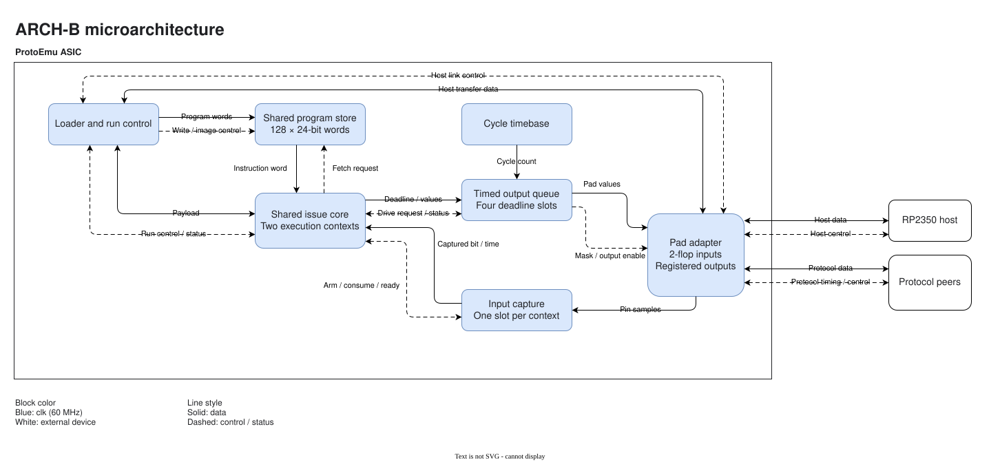

# ARCH-B microarchitecture

G4 draft for review. [DEC-001](../04_decisions/DEC-001-architecture.md) chooses a shared instruction store and issue path with independent timed I/O. It does not freeze these interfaces or the ISA.

[Editable draw.io overview](diagrams/arch-b_v2.drawio) · [Project diagram conventions](diagrams/README.md)



The arrows show logical paths, not physical pin assignments.

```text
RP2350 <-> pad adapter <-> loader -> shared program store <-> shared issue core
                           loader <------------------------> shared issue core
protocol pads <- pad adapter <- timed output queue <- shared issue core
protocol pads -> pad adapter -> context capture slots <-> shared issue core
cycle timebase -> shared issue core, timed output queue and capture slots
```

## Blocks and unit coverage

The area column partitions a provisional **0.600 mm² cell-area allowance**, not a fit prediction. It sets aside roughly half the 8×4 row area for routing and growth. The G3 probe measured 0.316 mm² after placement and repair for an incomplete design; no row below has measured block area yet. Reallocate after measuring the full loader, decode, pad routing and timed-I/O paths. The program store and core have the largest allowances because they contain the flop array and execution state.

| Block record | Boundary | Allowance (mm²) | Unit test |
|---|---|---:|---|
| [Core](BLK-CORE.md) | Two contexts, one fetch/execute path | 0.150 | `TEST-UNIT-001` |
| [Program store](BLK-PROGRAM.md) | 128 × 24-bit words, registered fetch | 0.180 | `TEST-UNIT-002` |
| [Timed output](BLK-DRIVE.md) | Four deadline slots and masked pad updates | 0.075 | `TEST-UNIT-003` |
| [Capture](BLK-CAPTURE.md) | One arm/result slot per context | 0.040 | `TEST-UNIT-004` |
| [Timebase](BLK-TIMER.md) | Cycle counter and deadline rule | 0.025 | `TEST-UNIT-005` |
| [Pad adapter](BLK-PADS.md) | Input synchronization, pad registers and mapping | 0.040 | `TEST-UNIT-006` |
| [Loader](BLK-HOST.md) | Image commit, run control and host payload | 0.090 | `TEST-UNIT-007` |

The [verification plan](../06_verif_plan.md) defines pass criteria. No new tests have run. In the overview all internal blocks use the same 60 MHz clock. The timebase carries cycle numbers, not a generated clock. The drawing shows its deadline path only; the endpoint tables describe all consumers, reset and status.

## Host and protocol pin split

[DEC-002](../04_decisions/DEC-002-loader-transport.md) selects dedicated RP2350 SPI0 and a separate reply-ready signal. All eight `uio` pads remain available for protocol I/O. See [BLK-PADS](BLK-PADS.md#pin-allocation) for the pin map and [BLK-HOST](BLK-HOST.md#spi-and-load-sequence) for the load sequence. The map has not been tested on the board.

## Decisions before agreement

| Decision | Evidence needed |
|---|---|
| Output admission, collision rules and four-slot sizing | Replay the critical EVAL-001 cases with full/retry and same-edge retirement; report admission slack and test whether a reservation is needed. |
| Capture ownership and wrap | Compare one slot per context with shared storage. Sweep rearm boundaries, simultaneous observations, and the proposed timestamp width. |
| Shared issue and ISA | Fix fetch, branch, blocked retry and fault timing. Rerun the encoded cases with those costs and record which ISA operations the examples need. |
| Host recovery and payload depth | Define timeout, abort, and retry behavior. Check the FIFO area and depth against the baseline programs. SPI transport and pin allocation are approved. |

The [G4 replay](../evals/EVAL-003-g4-timed-io.md) supports the draft timed-I/O contract on the tested cases. It does not freeze the ISA or verify RTL. Use the [G3 protocol runs](../evals/EVAL-001-protocol-comparison.md) and [physical probes](../evals/EVAL-002-area-timing.md) as baselines, not sign-off. Record decisions before agreeing the block records. Final routed setup, hold and tile fit remain open.
