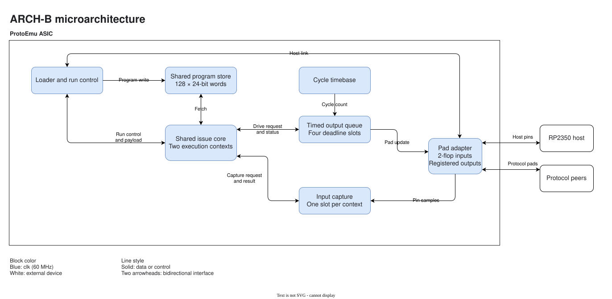

# ARCH-B microarchitecture

G4 draft for review. [DEC-001](../04_decisions/DEC-001-architecture.md) chooses a shared instruction store and issue path with independent timed I/O. It does not freeze these interfaces or the ISA.

[Editable draw.io overview](diagrams/arch-b_v1.drawio)



```text
RP2350 <-> pad adapter <-> loader -> shared program store <-> shared issue core
                           loader <------------------------> shared issue core
protocol pads <- pad adapter <- timed output queue <- shared issue core
protocol pads -> pad adapter -> context capture slots <-> shared issue core
cycle timebase -> shared issue core, timed output queue and capture slots
```

## Blocks and unit coverage

The area column partitions a provisional **0.600 mm² cell-area allowance**, not a fit prediction. It sets aside roughly half the 8×4 row area for routing and growth. The G3 probe measured 0.316 mm² after placement and repair for an incomplete design; no row below has measured block area yet. Reallocate after measuring the full loader, decode, pad routing and timed-I/O paths. The program store and core have the largest allowances because they contain the flop array and execution state.

| Block record | Boundary | Allowance (mm²) | Unit test |
|---|---|---:|---|
| [Core](BLK-CORE.md) | Two contexts, one fetch/execute path | 0.150 | `TEST-UNIT-001` |
| [Program store](BLK-PROGRAM.md) | 128 × 24-bit words, registered fetch | 0.180 | `TEST-UNIT-002` |
| [Timed output](BLK-DRIVE.md) | Four deadline slots and masked pad updates | 0.075 | `TEST-UNIT-003` |
| [Capture](BLK-CAPTURE.md) | One arm/result slot per context | 0.040 | `TEST-UNIT-004` |
| [Timebase](BLK-TIMER.md) | Cycle counter and deadline rule | 0.025 | `TEST-UNIT-005` |
| [Pad adapter](BLK-PADS.md) | Input synchronization, pad registers and mapping | 0.040 | `TEST-UNIT-006` |
| [Loader](BLK-HOST.md) | Image commit, run control and host payload | 0.090 | `TEST-UNIT-007` |

The [verification plan](../06_verif_plan.md) defines pass criteria. No new tests have run. In the overview all internal blocks use the same 60 MHz clock. The timebase carries cycle numbers, not a generated clock. The drawing shows its deadline path only; the endpoint tables describe all consumers, reset and status.

## Pin split to review

Candidate for a nibble handshake. This demonstrates a resource split, not a verified RP2350 transport or final board pinout.

| Tiny Tapeout resource | Candidate use |
|---|---|
| `ui_in[3:0]`, `ui_in[4]` | Host transmit nibble and request toggle |
| `uo_out[3:0]`, `uo_out[4]` | Host response nibble and acknowledgement toggle |
| `ui_in[7:5]`, `uo_out[7:5]` | Unused inputs; drive unused dedicated outputs low |
| `uio[3:0]` | SPI MOSI, MISO, SCLK and CS in the overlap example |
| `uio[4]`, `uio[7:5]` | UART RX and three spare protocol pads in that image |

Use software-selected pads for baseline I2C with external pull-ups. Validate the map on the demo board and test host signals crossing the two-flop synchronizers. Confirm the payload strategy can queue or return example data without host service on timing-critical edges.

## Decisions before agreement

| Decision | Evidence needed |
|---|---|
| Output admission, collision rules and four-slot sizing | Replay the critical EVAL-001 cases with full/retry and same-edge retirement; report admission slack and test whether a reservation is needed. |
| Capture ownership and wrap | Compare one slot per context with shared storage. Sweep rearm boundaries, simultaneous observations, and the proposed timestamp width. |
| Shared issue and ISA | Fix fetch, branch, blocked retry and fault timing. Rerun the encoded cases with those costs and record which ISA operations the examples need. |
| Host transport, payload, and pin allocation | Compare the nibble handshake with a serial alternative, validate pin mapping and stopped-state behavior, measure modeled load time, then freeze framing and configuration. |

The [G4 replay](../evals/EVAL-003-g4-timed-io.md) supports the draft timed-I/O contract on the tested cases. It does not freeze the ISA or verify RTL. Use the [G3 protocol runs](../evals/EVAL-001-protocol-comparison.md) and [physical probes](../evals/EVAL-002-area-timing.md) as baselines, not sign-off. Record decisions before agreeing the block records. Final routed setup, hold and tile fit remain open.
