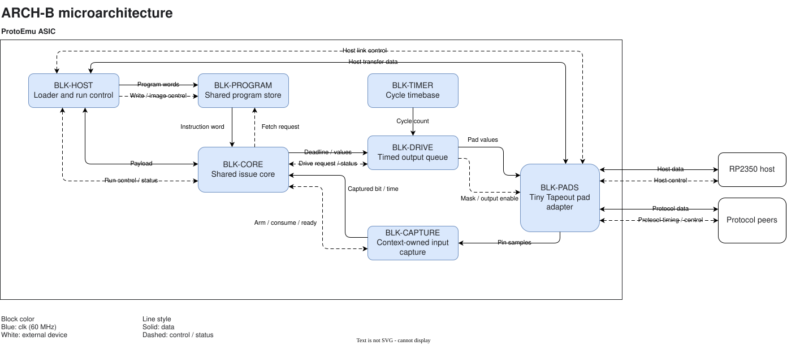

# ARCH-B microarchitecture

Lingga agreed the G4 block contracts in TASK-050. [DEC-001](../04_decisions/DEC-001-architecture.md) chooses a shared instruction store and issue path with independent timed I/O. The ISA encoding is still provisional.

[G4 review package](g4-review.md) · [Draft ISA and open instructions](isa-draft.md) · [Chip and block sequences](sequences.md)

[Editable draw.io overview](diagrams/arch-b_v3.drawio) · [Project diagram conventions](diagrams/README.md)



The arrows show logical paths, not physical pin assignments. Use the `BLK-*` IDs in the diagram to find the matching records below. Each record has its own internal diagram.

```text
RP2350 <-> BLK-PADS <-> BLK-HOST -> BLK-PROGRAM <-> BLK-CORE
                        BLK-HOST <---------------> BLK-CORE
Protocol peers <- BLK-PADS <- BLK-DRIVE <- BLK-CORE
Protocol peers -> BLK-PADS -> BLK-CAPTURE <-> BLK-CORE
BLK-TIMER -> BLK-CORE, BLK-DRIVE, BLK-CAPTURE
```

## Blocks and unit coverage

The area column partitions a provisional **0.600 mm² cell-area allowance**, not a fit prediction. It sets aside roughly half the 8×4 row area for routing and growth. The G3 probe measured 0.316 mm² after placement and repair for an incomplete design; no row below has measured block area yet. Reallocate after measuring the full loader, decode, pad routing and timed-I/O paths. The program store and core have the largest allowances because they contain the flop array and execution state.

| Block record | Boundary | Allowance (mm²) | Unit test |
|---|---|---:|---|
| [BLK-CORE](BLK-CORE.md): Shared issue core | Two contexts, one fetch/execute path | 0.150 | `TEST-UNIT-001` |
| [BLK-PROGRAM](BLK-PROGRAM.md): Shared program store | 128 × 24-bit words, registered fetch | 0.180 | `TEST-UNIT-002` |
| [BLK-DRIVE](BLK-DRIVE.md): Timed output queue | Four deadline slots and masked pad updates | 0.075 | `TEST-UNIT-003` |
| [BLK-CAPTURE](BLK-CAPTURE.md): Context-owned input capture | One arm/result slot per context | 0.040 | `TEST-UNIT-004` |
| [BLK-TIMER](BLK-TIMER.md): Cycle timebase | Cycle counter and deadline rule | 0.025 | `TEST-UNIT-005` |
| [BLK-PADS](BLK-PADS.md): Tiny Tapeout pad adapter | Input synchronization, pad registers and mapping | 0.040 | `TEST-UNIT-006` |
| [BLK-HOST](BLK-HOST.md): Loader and run control | Image commit, run control and host payload | 0.090 | `TEST-UNIT-007` |

The [verification plan](../06_verif_plan.md) lists test status and pass criteria. All internal blocks use the same 60 MHz clock. `BLK-TIMER` sends cycle numbers, not a clock. The drawing shows its deadline path only. The block records describe all consumers, reset and status.

## Host and protocol pin split

[DEC-005](../04_decisions/DEC-005-loader-rate.md) selects dedicated RP2350 SPI0 at 1 MHz and a separate reply-ready signal, replacing DEC-002. All eight `uio` pads remain available for protocol I/O. See [BLK-PADS](BLK-PADS.md#pin-allocation) for the pin map and [BLK-HOST](BLK-HOST.md#spi-and-load-sequence) for the load sequence. The map has not been tested on the board.

## Decisions before agreement

| Decision | Evidence needed |
|---|---|
| Output admission, collision rules and four-slot sizing | [EVAL-003](../evals/EVAL-003-g4-timed-io.md) supports four slots without reservations for the tested workload. Check pending-operation behavior in the integrated core. |
| Capture ownership and wrap | EVAL-003 checks simultaneous observations and wrap. Confirm rearm behavior with the proposed edge-capture encoding and non-target programs. |
| Shared issue and ISA | [EVAL-007](../evals/EVAL-007-eight-pad-encoding.md) replays compact and vector formats for eight pads. [EVAL-008](../evals/EVAL-008-eight-pad-timing.md) checks setup and hold on a placed slice. Review the ISA and check full-core integration and routed timing separately. |
| Host timing and payload depth | [CHG-002](../changes/CHG-002-loader-recovery.md) defines recovery. Verify the provisional timeouts on the board and check FIFO area and depth against the baseline programs. |

The [G4 replay](../evals/EVAL-003-g4-timed-io.md) supports the draft timed-I/O contract on the tested cases. It does not freeze the ISA or verify RTL. Use the [G3 protocol runs](../evals/EVAL-001-protocol-comparison.md) and [physical probes](../evals/EVAL-002-area-timing.md) as baselines, not sign-off. Record decisions before agreeing the block records. Final routed setup, hold and tile fit remain open.
