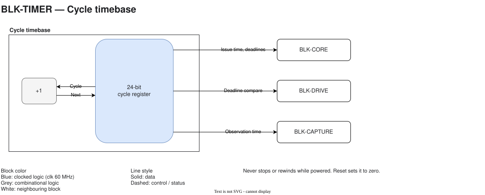
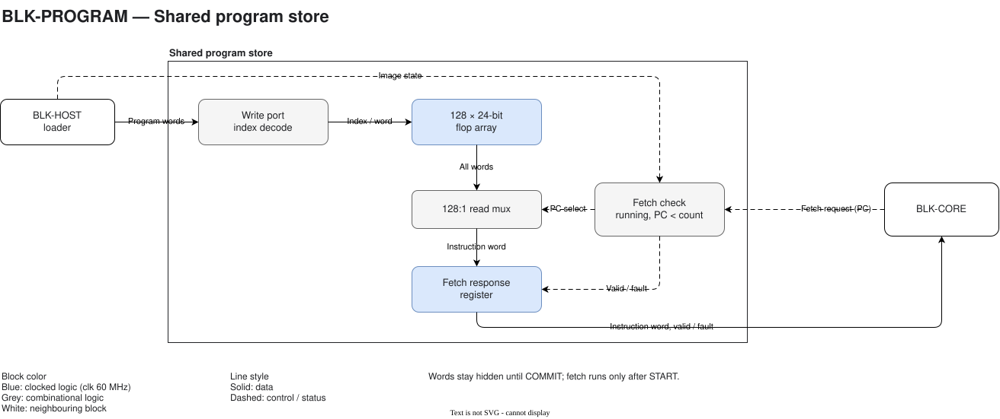
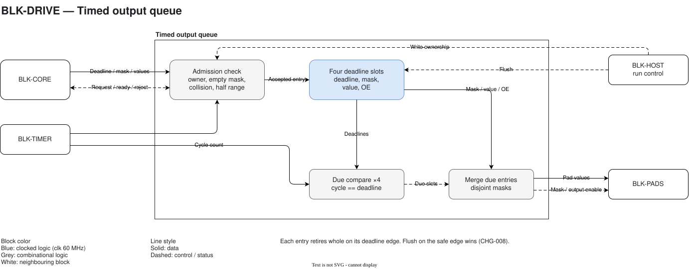
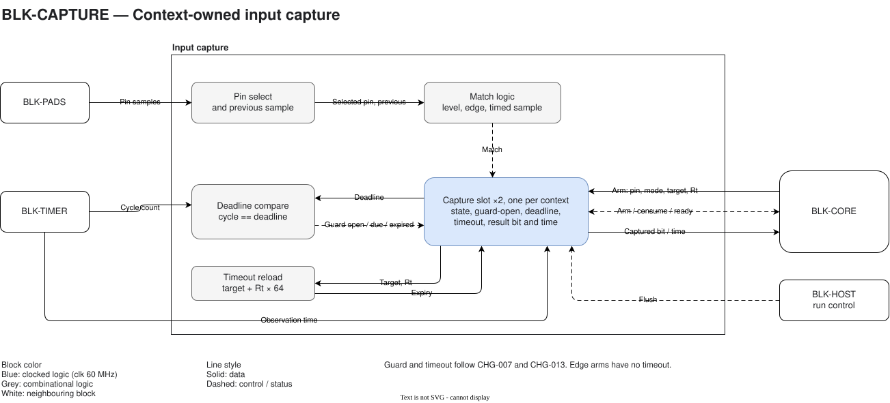
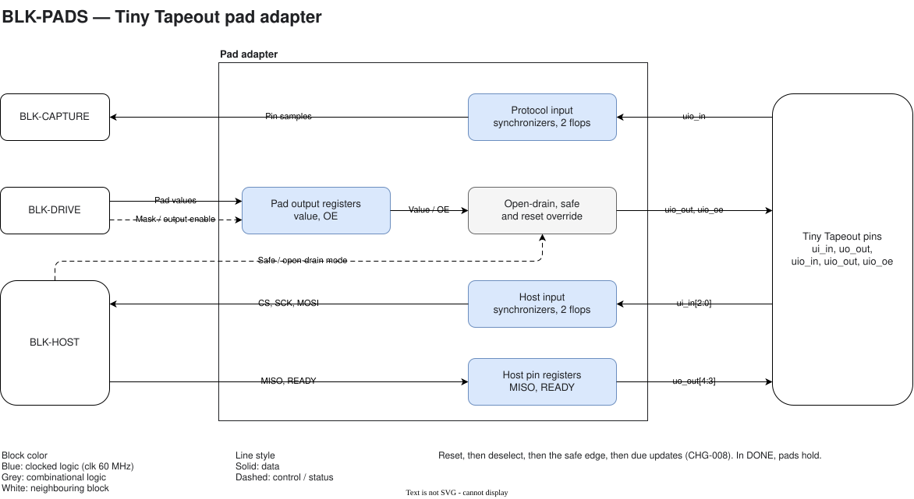
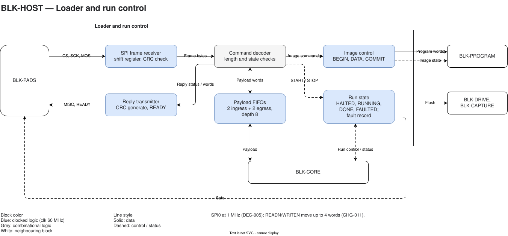
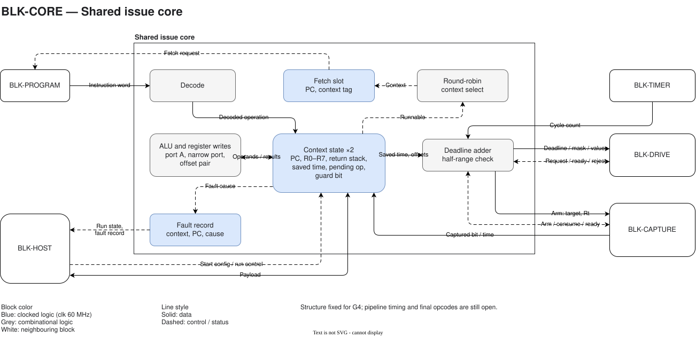

# G4 block review sheets

Prepared in TASK-049 for [g4-review](g4-review.md) step 2. One sheet per block: what is settled, what this review fixed, how the unit test covers it, and what stays open. Gate G4 needs every block `agreed` and each with a unit test; the checker reports no other open point. Only Lingga agrees a block.

Lingga agreed all seven block contracts in TASK-050 on 2026-11-22. The open implementation and physical checks below still apply.

"Open" items are listed in two kinds. **Before RTL** items do not block agreeing the block's behavior and interfaces, but must be closed in G5. **Tracked separately** items are physical checks (g4-review step 3) that do not gate G4.

For the order of events and handoffs, see the [chip sequence and block drill-downs](sequences.md).

| Block | Recommendation | Unit test | Area evidence (planning allowance) |
|---|---|---|---|
| [BLK-TIMER](BLK-TIMER.md) | Agree | TEST-UNIT-005 | Not measured (0.025 mm²) |
| [BLK-PROGRAM](BLK-PROGRAM.md) | Agree | TEST-UNIT-002 | Not measured at 128 words (0.180 mm²) |
| [BLK-DRIVE](BLK-DRIVE.md) | Agree | TEST-UNIT-003 | Not measured (0.075 mm²) |
| [BLK-CAPTURE](BLK-CAPTURE.md) | Agree | TEST-UNIT-004 | Two slots with timeout 0.015 mm² (0.040 mm²) |
| [BLK-PADS](BLK-PADS.md) | Agree | TEST-UNIT-006 | Not measured (0.040 mm²) |
| [BLK-HOST](BLK-HOST.md) | Agree, with board check noted | TEST-UNIT-007 | Payload FIFOs 0.046 mm² (0.090 mm²) |
| [BLK-CORE](BLK-CORE.md) | Agree, with open RTL items noted | TEST-UNIT-001 | Register file 0.024 mm² (0.150 mm²) |

All areas are typical-corner synthesis of probes, not placed blocks.

---

## Cycle timebase (BLK-TIMER)

**Settled.** One free-running 24-bit counter (DEC-003). Consumers use the pre-edge value. Admission accepts deltas 1 to `2^23 − 1` for drives and samples. Guards classify once and stay open (CHG-007). Elapsed time is modulo `2^24` (CHG-006).

**Fixed in this review.** The width was still marked "proposed" and the options text still compared 16 bits. Both now record 24 bits as used by DEC-003, CHG-007 and CHG-013.

**Unit test (TEST-UNIT-005).** Reset value, exact increment, the 0 / 1 / `2^23−1` / `2^23` / all-ones deltas, wrap, guard classification, and no second timebase.

**Open.** Tracked separately: carry path and fanout timing.

## Shared program store (BLK-PROGRAM)

**Settled.** A 128 × 24-bit flop array with registered read. Tentative words stay hidden until `COMMIT`, and fetch is enabled only after `START`. An out-of-image fetch returns a fault. Both pad formats are stored unchanged (DEC-004).

**Fixed in this review.** Nothing; the record matches CHG-005 to CHG-013.

**Unit test (TEST-UNIT-002).** Word counts 1 and 128 with both endpoints, a shorter reload over a longer image, reads before commit and writes during run, a CRC failure after tentative writes, fetch latency, and reset visibility without assuming initialized memory.

**Open.** Tracked separately: 128-way read-mux setup timing (partition the mux if it fails) and the array's placed area.

## Timed output queue (BLK-DRIVE)

**Settled.**
- Four unordered slots (EVAL-003). Admission rejects an empty mask, an unowned pad, a same-deadline overlap or a deadline outside the future half.
- Due entries merge and retire whole. A vector update takes one slot (DEC-004).
- Updates due on the fault edge retire; flush on the next edge suppresses the rest (CHG-008).

**Fixed in this review.** The options text still offered ordered insertion. It now records unordered slots with a due scan, and the EVAL-008 hold result.

**Unit test (TEST-UNIT-003).** Out-of-order deadlines, multi-retire, reuse on the retirement edge, collisions, expired retry, wrap, full-width vector admission, and the fault-edge and flush edges.

**Open.** Tracked separately: scan, merge and OE timing; EVAL-008 missed fast hold on a slice.

## Context-owned input capture (BLK-CAPTURE)

**Settled.**
- One slot per context (EVAL-003). The observation is timestamped with the pre-edge cycle.
- Edge arms ignore the arm edge (CHG-006).
- Guarded level arms classify once (CHG-007). A guarded arm may also be timed, reloading its deadline when the guard opens (CHG-013).
- Observations on the fault edge count, and flush clears both slots (CHG-008).

**Fixed in this review.**
- The interface table lacked the guard flag, the `Rt` timeout and the `expired` result added by CHG-013; they are now listed.
- "The capture slot does not add a timeout" now reads "edge arms have no timeout".
- The options text still compared a shared FIFO; it now records fixed slots and the EVAL-017 area.

**Unit test (TEST-UNIT-004).** Ownership, two results on one edge, arm-edge transitions, levels already present, wrap, stalled consume, all three edge modes, guard targets, a late level after `2^23` cycles, timed arms (match, expiry, same-edge, `Rt = 0`), and flush.

**Open.** Before RTL: compare storing `Rt` and reloading against receiving a precomputed expiry (24 flops), as CHG-013 notes.

## Tiny Tapeout pad adapter (BLK-PADS)

**Settled.**
- Two flops on every input. Registered outputs.
- Open drain releases on high. A cleared enable releases a pad.
- Priority on one edge: reset, then deselect, then safe, then updates. Pads hold in `DONE` (CHG-008).
- Pin map: dedicated host pins plus eight programmable `uio` pads (DEC-005).

**Fixed in this review.** Nothing; the record matches. The diagram shows the protocol and host synchronizers as separate groups of the same two-flop structure.

**Unit test (TEST-UNIT-006).** Two-flop path, partial updates, open-drain low and release, reset and safe precedence in every combination, `DONE` hold, and the host pin mapping.

**Open.** Tracked separately: first-stage input hold after clock-tree synthesis, and the board pin and electrical check.

## Loader and run control (BLK-HOST)

**Settled.**
- SPI0 at 1 MHz with `READY` (DEC-005). Framed commands with CRC. `BEGIN`/`DATA`/`COMMIT`/`START`/`STOP`.
- Recovery rules (CHG-002). Run states and the fault record (CHG-008).
- Depth-8 FIFOs with the registered-status rule (CHG-010). `READN`/`WRITEN` with up to four words (CHG-011).

**Fixed in this review.** Nothing in the text; it already reflects CHG-010 and CHG-011. In the diagram, CRC check and generation are drawn inside the receiver and transmitter.

**Unit test (TEST-UNIT-007).** Frame validation (short, overlong, bad CRC, early and late ends), commit before start, payload FIFO order and full/empty, same-edge access, `READN`/`WRITEN` including an interrupted reply and a bad CRC, `DONE`/`FAULTED` payload and `STOP`, and reset during a request.

**Open.**
- Before RTL: numeric opcode and status values; area of the SPI framing, CRC and run control (FIFOs alone use about half the allowance).
- Tracked separately: 1 MHz SPI on the real board (fallback 500 kHz), and the provisional host deadlines.

## Shared issue core (BLK-CORE)

**Settled.**
- Two contexts, registered fetch then execute, round-robin issue, saved requests retried without refetch.
- Timestamps (DEC-003), pad formats (DEC-004), payload operations (CHG-005), edges and intervals (CHG-006).
- Guards (CHG-007), fault ordering (CHG-008), two-word writeback through a narrow port (CHG-009).
- LSB-first `shift_pin` (CHG-012) and `wait_to` (CHG-013).
- All 914 baseline and non-target cases pass in the model (EVAL-016).

**Fixed in this review.**
- `run_status` now names the run state and fault record.
- The "decode and fault rules need a decision" and "encodings remain open" sentences now say what the draft ISA settles and what stays provisional.
- The re-fetch option is recorded as rejected.
- The CHG-013 paragraph now follows the CHG-007 rule it builds on.

**Unit test (TEST-UNIT-001).** Context isolation, blocked issue and retry identity, saved and invalid timestamps, wrap, every drive format and shift order, payload stalls, `edge_delta` writeback, guards, fault-edge behavior, and `wait_to` expiry.

**Open.**
- Before RTL: final opcode values; the R0/R6 offset-register assignment; the deadline-adder operand for `wait_to` (not measured).
- Tracked separately: full-core timing with the saved-request path and real register file (g4-review step 3). The diagram is drawn for G4 and may change if that check forces a different pipeline.
