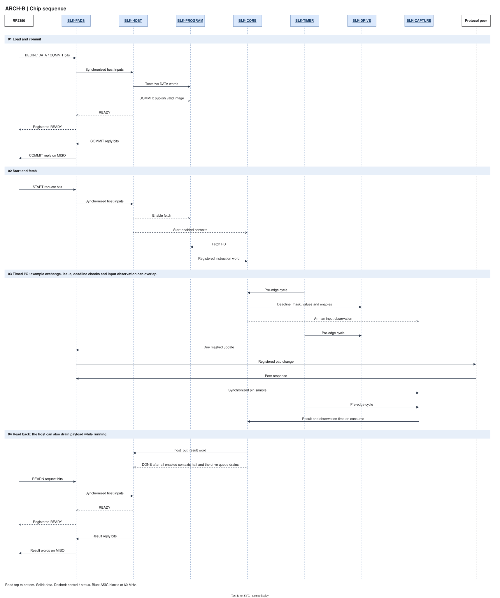
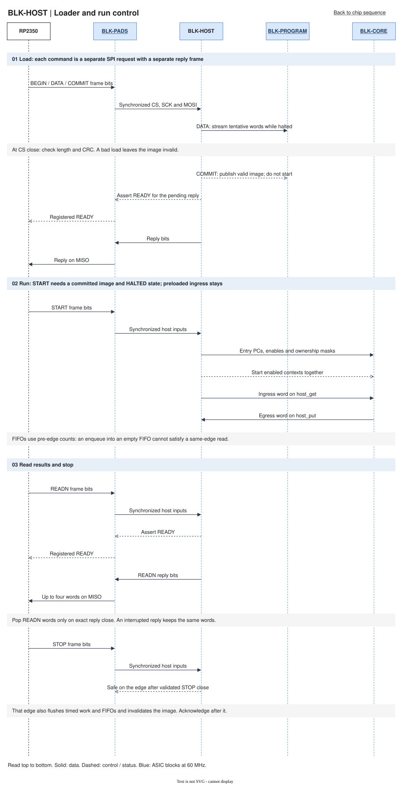
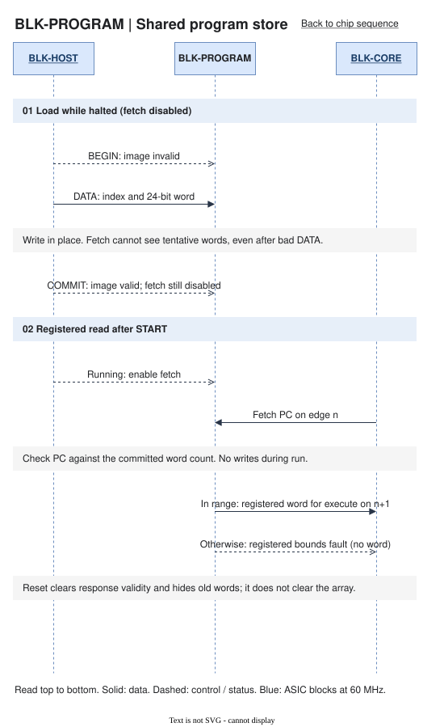
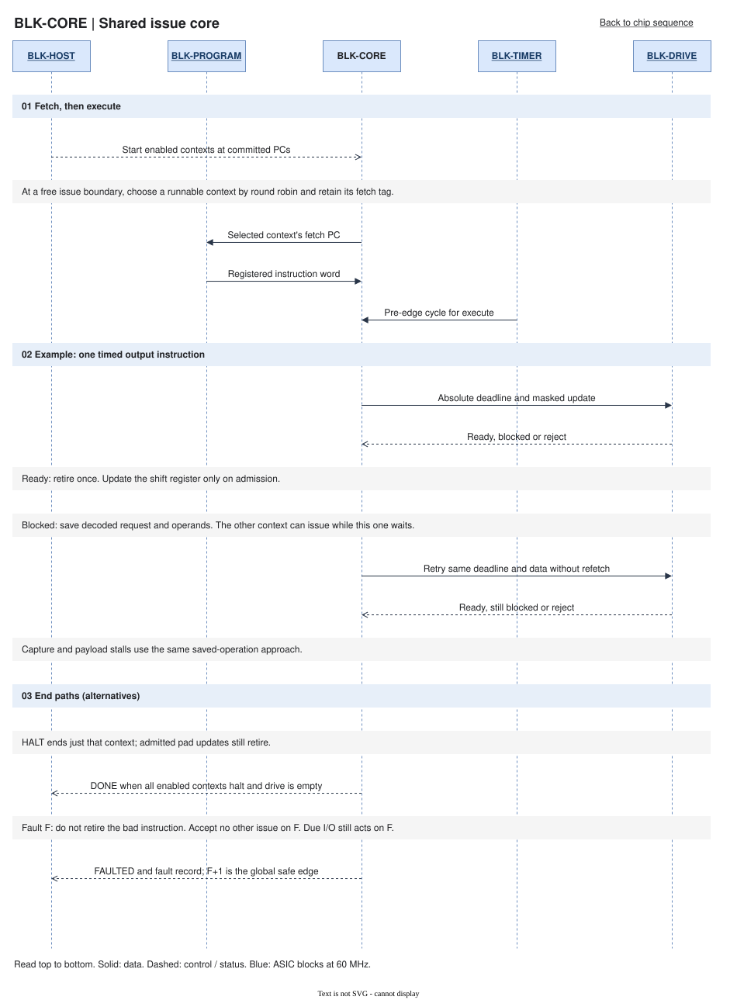
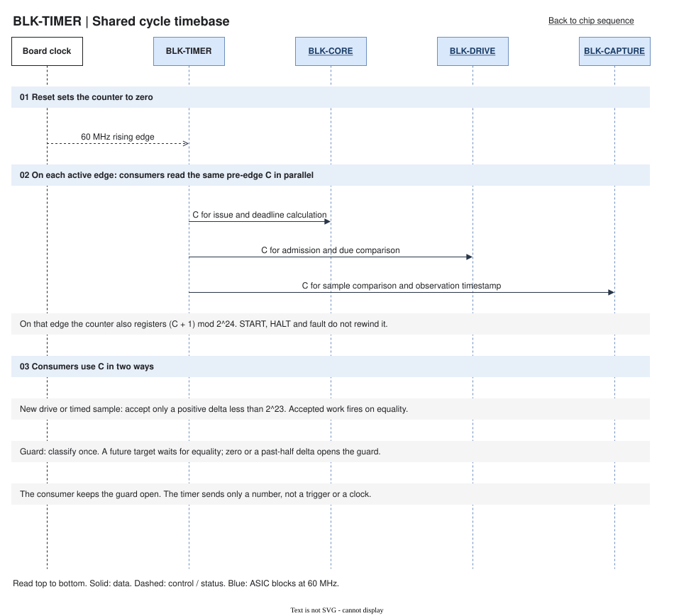
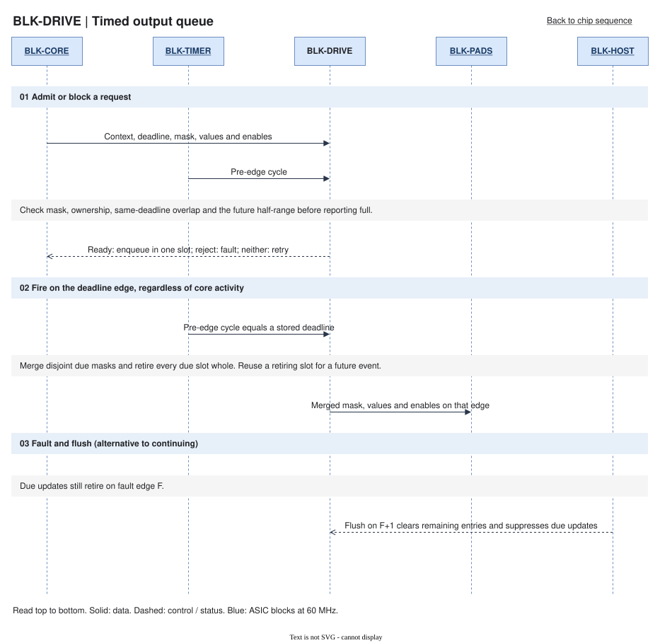
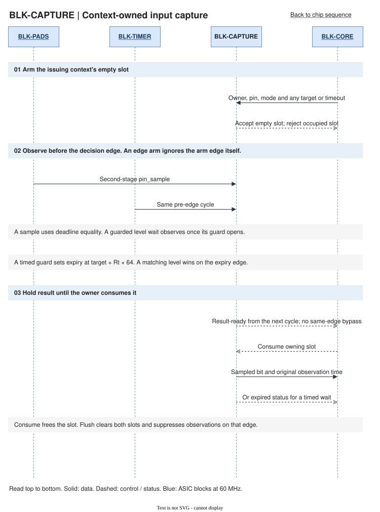
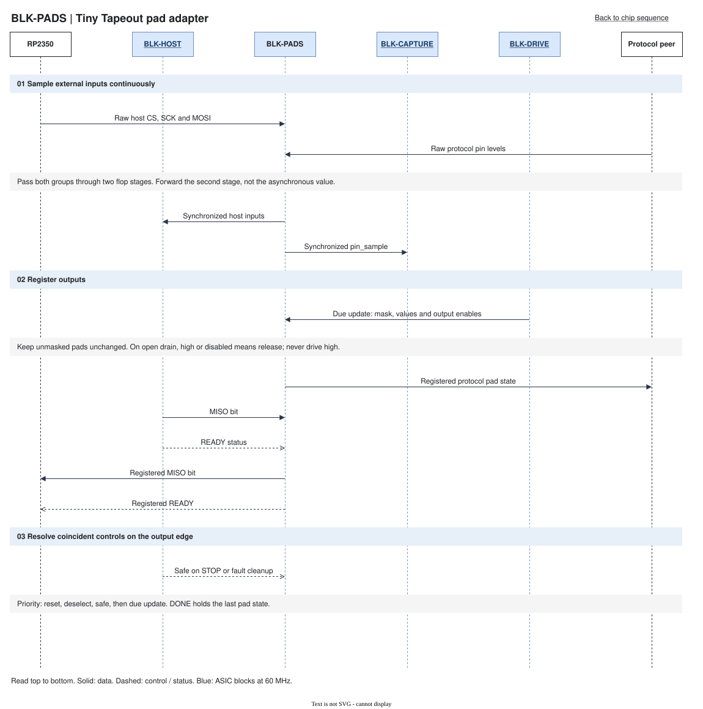

# ARCH-B sequence diagrams

[Editable draw.io book](diagrams/arch-b-sequences_v1.drawio) · [Chip block diagram](diagrams/arch-b_v2.svg) · [ISA draft](isa-draft.md)

The block diagrams show what connects. The sequences show when each block acts and what it hands off. In draw.io, follow a linked block header to its sequence page. Each detail page links back to the chip page. The SVGs below are static views.

## Chip sequence

The host loads an image with `BEGIN`, `DATA` and `COMMIT`. Only a separate `START` enables fetch. The core issues instructions ahead of the pins: drive and capture use the same free-running cycle count and do not need an issue slot when an event comes due. One context can stall while the other issues. The program sends results through `host_put`; the RP2350 can drain them while running or after `DONE` or `FAULTED`.

Read the diagrams top to bottom. Spacing is not cycle count. Arrows show logical handoffs, not extra signals or mandatory wait cycles. Operations labeled for the same edge happen in parallel. The [block records](g4-block-review.md) define the full draft contracts.

| Chip phase | Block sequence pages |
|---|---|
| 01 Load and commit | [Host](#host), [Program store](#program-store), [Pad adapter](#pad-adapter) |
| 02 Start and fetch | [Host](#host), [Program store](#program-store), [Issue core](#issue-core) |
| 03 Timed I/O | [Issue core](#issue-core), [Timebase](#timebase), [Timed output](#timed-output), [Input capture](#input-capture), [Pad adapter](#pad-adapter) |
| 04 Readback | [Host](#host), [Issue core](#issue-core), [Pad adapter](#pad-adapter) |

## Host

[BLK-HOST](BLK-HOST.md) · [Block diagram](diagrams/blk-host_v1.svg) · [Back to chip sequence](#chip-sequence)

## Program store

[BLK-PROGRAM](BLK-PROGRAM.md) · [Block diagram](diagrams/blk-program_v1.svg) · [Back to chip sequence](#chip-sequence)

## Issue core

[BLK-CORE](BLK-CORE.md) · [Block diagram](diagrams/blk-core_v1.svg) · [Back to chip sequence](#chip-sequence)

## Timebase

[BLK-TIMER](BLK-TIMER.md) · [Block diagram](diagrams/blk-timer_v1.svg) · [Back to chip sequence](#chip-sequence)

## Timed output

[BLK-DRIVE](BLK-DRIVE.md) · [Block diagram](diagrams/blk-drive_v1.svg) · [Back to chip sequence](#chip-sequence)

## Input capture

[BLK-CAPTURE](BLK-CAPTURE.md) · [Block diagram](diagrams/blk-capture_v1.svg) · [Back to chip sequence](#chip-sequence)

## Pad adapter

[BLK-PADS](BLK-PADS.md) · [Block diagram](diagrams/blk-pads_v1.svg) · [Back to chip sequence](#chip-sequence)

